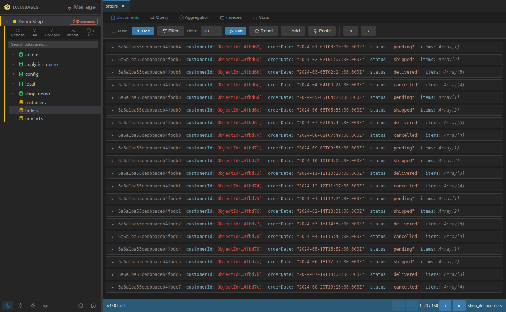
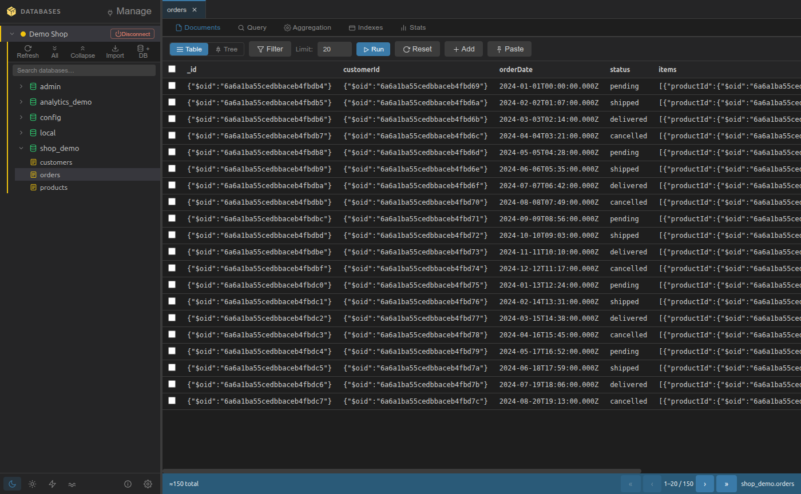
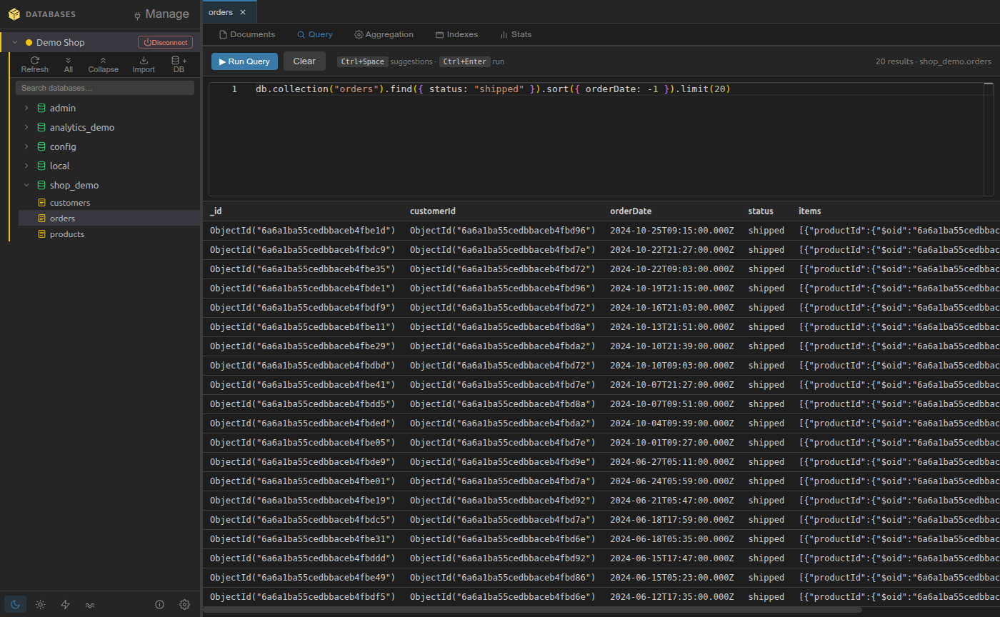
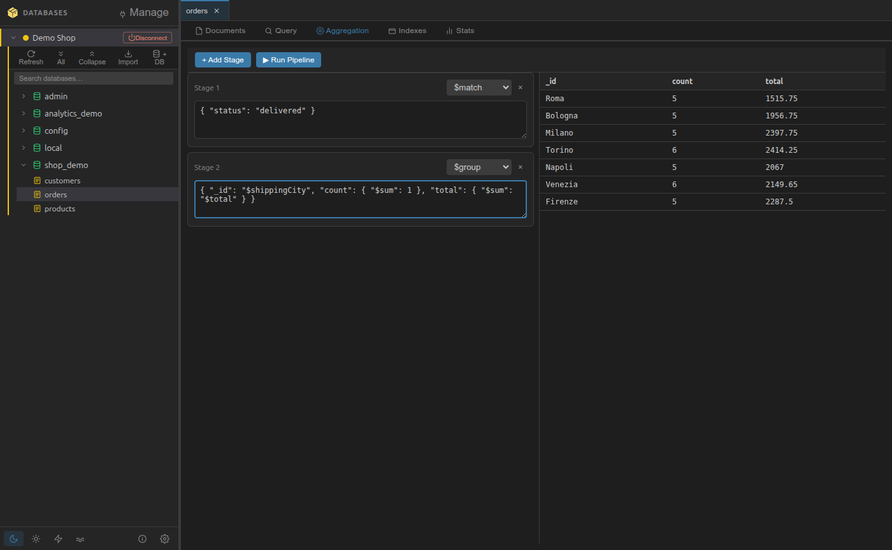
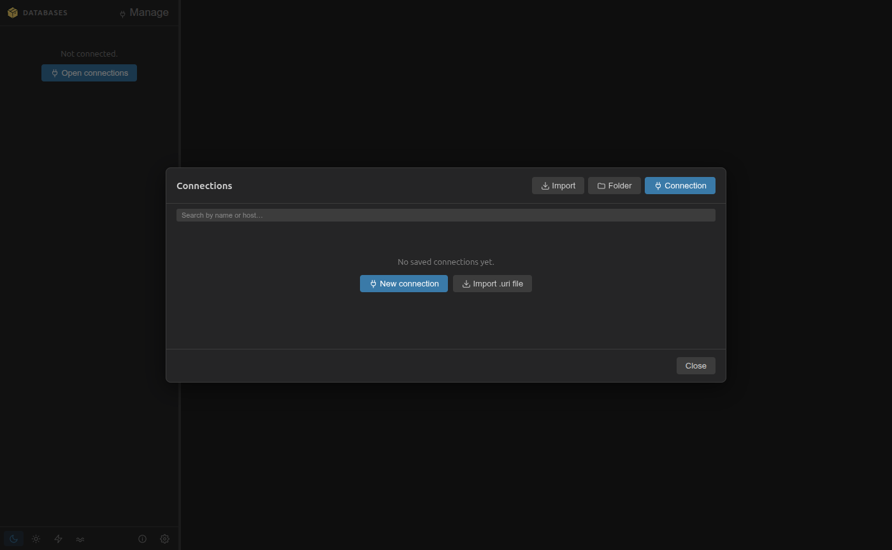
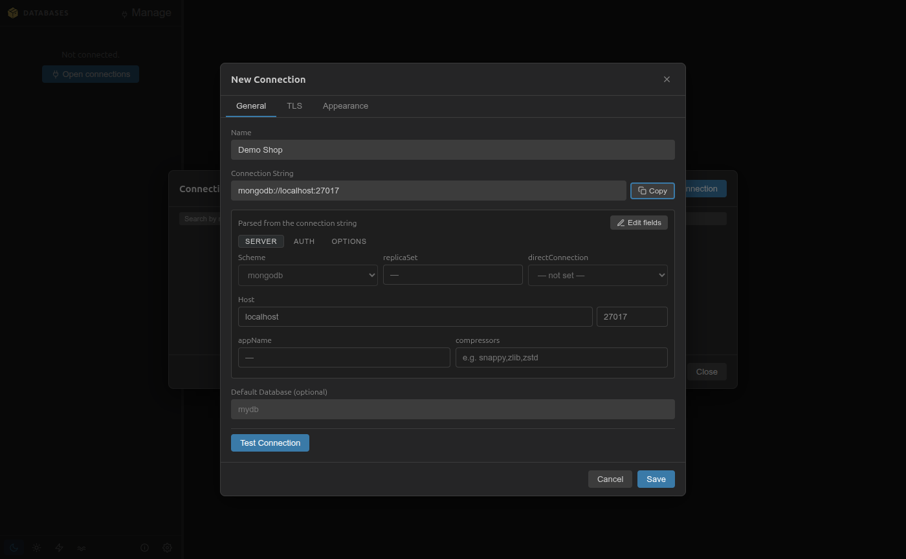

# BoxyNoSql

Desktop NoSQL GUI client. Explore connections, databases, collections and documents.

## Features

- ✅ Connection management (saved in `~/.config/BoxyNoSql/connections.json`)
- ✅ Folder organization with drag & drop, color coding
- ✅ Import connections from a Studio 3T `.uri` export: folders, colors and client certificates come along, Studio 3T-only options are translated or stripped
- ✅ Database/collection tree view with search across every database's collections (no need to expand them first), plus a command palette (`Ctrl+P`) over connections, databases, collections and actions
- ✅ Document viewer (tree + table), filter on a field by dragging it or with one click, ObjectId details on hover (creation date, machine, PID, counter), multi-select, bulk copy/paste/delete and bulk field edit (set/rename/unset across the selection)
- ✅ Paginated document browsing with configurable limit
- ✅ Visual filter builder (open by default, resizable) with a JSON editor for the filter: edit it as JSON and it goes back into the builder, or stays as a custom filter when the builder can't express it
- ✅ Server-side sort on one or more fields — from the query panel (order and direction per field) or the column headers (shift-click for a second key) — and per-collection field visibility
- ✅ Query history per collection (filters, queries, pipelines) with named saved queries, kept across restarts
- ✅ Pinned collections, last session restored on startup (connections and tabs, can be turned off), connection health with auto-reconnect
- ✅ Shortcut cheat sheet (F1), guided welcome screen, connection clone, CSV/TSV import
- ✅ Document view/edit with JSON syntax highlighting, shell-style `ObjectId(...)` / `ISODate(...)` (dates stay dates when saved, Studio 3T's `ISODate("…+0000")` accepted), foldable sections with expand/collapse all, find, and a list of changes before saving that shows each changed line
- ✅ Query terminal with Monaco editor: autocompletion (Ctrl+Space), Mongo method/operator/field suggestions, Ctrl+Enter to run, resizable split
- ✅ Aggregation pipeline builder with a Monaco editor per stage, completions, stage templates and a document counter per stage
- ✅ Explain plan on the current filter, query or pipeline: index used or collection scan, documents and keys examined, stage timings, a verdict when far more is read than returned, and the raw output one click away
- ✅ Index management (create/drop) with usage stats
- ✅ Collection stats and a schema explorer (sampled field list with types, presence and example values)
- ✅ Copy a collection or a whole database across connections, with a confirmation naming both ends and an automatic refresh of the target
- ✅ Import from JSON / NDJSON at three levels (document, collection, full database)
- ✅ Export to JSON / NDJSON / CSV through a native save dialog: the current filtered+sorted view, the whole collection, or a query/aggregation result
- ✅ User/role management per database
- ✅ Per-tab persistent state: switching between collections/views keeps filters and results
- ✅ Large pages without the freeze: both document views are windowed, so only the rows near the viewport are in the DOM and a limit of a few thousand scrolls instead of locking up
- ✅ Read-only connections: a per-connection flag that refuses every write in the main process, not just in the UI
- ✅ Typed confirmation on drop/clear: retype the name, with the document count shown up front
- ✅ Four themes: dark 🌙 / light ☀️ / high-contrast ⚡ / solarized 🌊, adjustable text size (80 / 100 / 120%)
- ✅ Sound cues on connect, disconnect, tree refresh, a successful connection test and connection errors (can be turned off)

## Screenshots

| | |
|---|---|
| **Documents — tree view**  | **Documents — table view**  |
| **Query terminal**  | **Aggregation pipeline builder**  |
| **Connection manager**  | **Connection string breakdown**  |

*(Dark theme shown; light, high-contrast and solarized are also available. Sample data, no real servers or data pictured.)*

## Roadmap

- [ ] AppImage sandbox flags on every launch, not only via the documented `.desktop` entry
- [ ] Edit an existing user's roles (today: drop and recreate)
- [ ] Database row: expand only on chevron click or double-click, not on any click
- [ ] Right-click a database → open a query shell scoped to the whole database

Designs in [ROADMAP.md](ROADMAP.md). Everything else that was planned has shipped — see Features above and [CHANGELOG.md](CHANGELOG.md).

## Install

```bash
npm install
```

## Development

```bash
npm run dev    # start Vite + tsc watchers
npm start      # open Electron (after dev server is up)
npm run check  # typecheck main + renderer, lint, then run the tests
```

### Keyboard

`Esc` cancels the innermost thing open, everywhere. `Alt+Enter` runs the current filter, query or pipeline (`Ctrl+Enter` also works in the editors). `F1` lists every other shortcut.

## Build

```bash
npm run electron:build:linux   # .deb + AppImage
npm run electron:build:win     # NSIS installer
npm run electron:build:all     # both
```

Installers are written to `release/`.

**Windows users:** see [INSTALL_WINDOWS.md](INSTALL_WINDOWS.md) for install, build and troubleshooting steps.

**Linux/Ubuntu users:** see [INSTALL_LINUX.md](INSTALL_LINUX.md) — `.deb` vs AppImage, auto-update (AppImage only), pinning the AppImage to the dock, and troubleshooting.

## Usage

1. Open the app
2. Click `🔌 +` to add a connection (or right-click the sidebar)
3. Enter name and connection string (e.g. `mongodb://localhost:27017`)
4. Double-click connection to connect
5. Click a collection to open it

## Mongo test docker

```bash
docker run -d --name mongodb-dev -p 27017:27017 -e MONGO_INITDB_ROOT_USERNAME=admin -e MONGO_INITDB_ROOT_PASSWORD=secret mongo:7

docker exec -it mongodb-dev mongosh -u admin -p secret --authenticationDatabase admin
```

## License

MIT — see [LICENSE](LICENSE)
